# Manual de usuario de RutaSegura

RutaSegura le ayuda a saber **si las personas de su local pueden salir a tiempo durante un
sismo**. Parte de una foto o un PDF del plano y lo guía en 7 pasos:

1. Cargar plano.
2. Escala.
3. Corregir plano.
4. Ambientes y ocupantes.
5. Revisar norma.
6. Simular.
7. Informe.

> **Importante.** Este informe es de apoyo y no reemplaza la Inspección Técnica de Seguridad en
> Edificaciones (ITSE) ni el estudio de un profesional colegiado.

RutaSegura **funciona sin internet**: sus planos y datos nunca salen de su computadora.

---

## Instalación

**Requisitos:** Windows 10 u 11 (64 bits). Se recomiendan 8 GB de memoria.

1. Ejecute `RutaSegura-<versión>-instalador.exe`. Se instala para su usuario, sin pedir permisos
   de administrador.
2. Si Windows muestra «Windows protegió su PC», elija **Más información › Ejecutar de todas
   formas**. El aviso aparece porque el instalador no está firmado digitalmente.
3. Abra RutaSegura desde el menú Inicio o desde el acceso directo del escritorio.

**Versión portable:** descomprima `RutaSegura-<versión>-portable.zip` en cualquier carpeta y
abra `RutaSegura.exe`.

**Dónde se guardan sus datos:** en `%LOCALAPPDATA%\RutaSegura`, que incluye la base de datos, las
imágenes de los planos y las simulaciones. Desinstalar el programa **no** borra sus proyectos.

---

## Antes de empezar: el proyecto

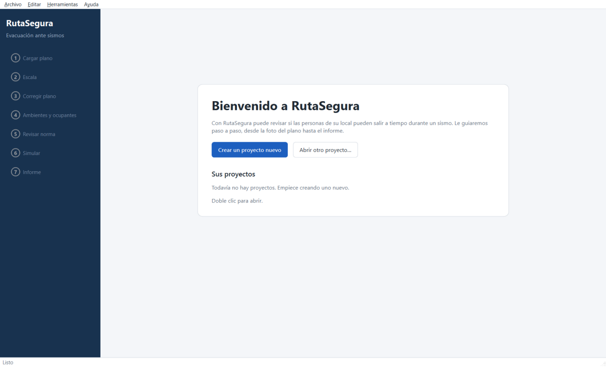

Un **proyecto** es un local: un colegio, una oficina o una tienda.

- **Proyecto nuevo:** use **Crear un proyecto nuevo** (o el menú Archivo › Nuevo proyecto) y
  escriba el nombre, el tipo de local y, si quiere, la dirección.
- **Proyecto existente:** use **Abrir un proyecto existente**.

Los cambios se guardan solos cada vez que pasa de un paso a otro y al cerrar el programa. También
puede guardar con **Ctrl+S**.

---

## Paso 1. Cargar plano

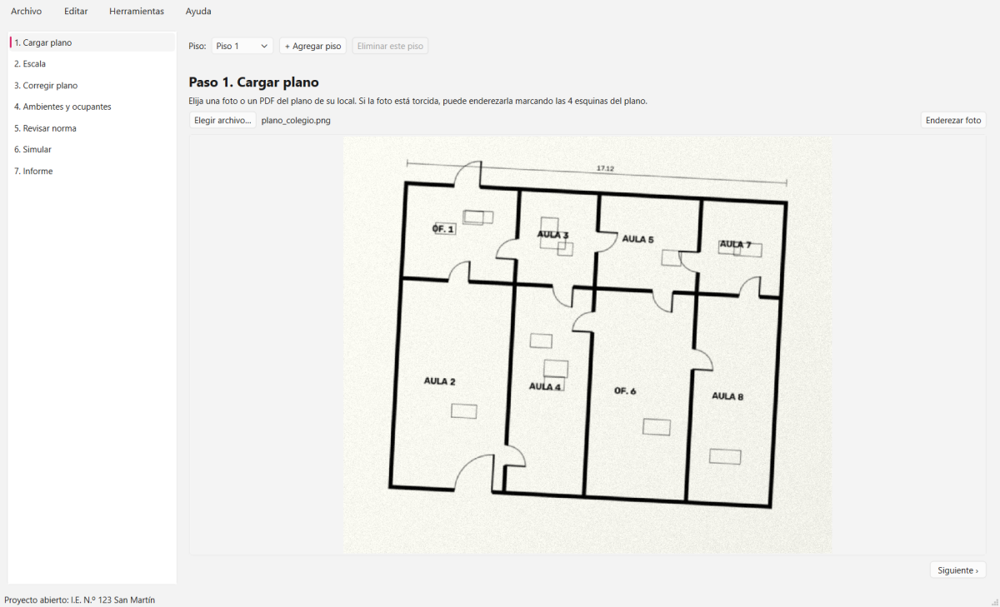

1. Pulse **Elegir archivo…** y seleccione una foto (JPG o PNG) o un PDF del plano.
2. Si el PDF tiene varias páginas, elija la página del plano.
3. **Si la foto está torcida**, pulse **Enderezar foto** y haga clic en las 4 esquinas del plano,
   en cualquier orden. Si no le gusta el resultado, pulse **Quitar enderezado**.

> **Consejo:** tome la foto de frente, con buena luz y que el plano ocupe casi toda la imagen.

---

## Paso 2. Escala

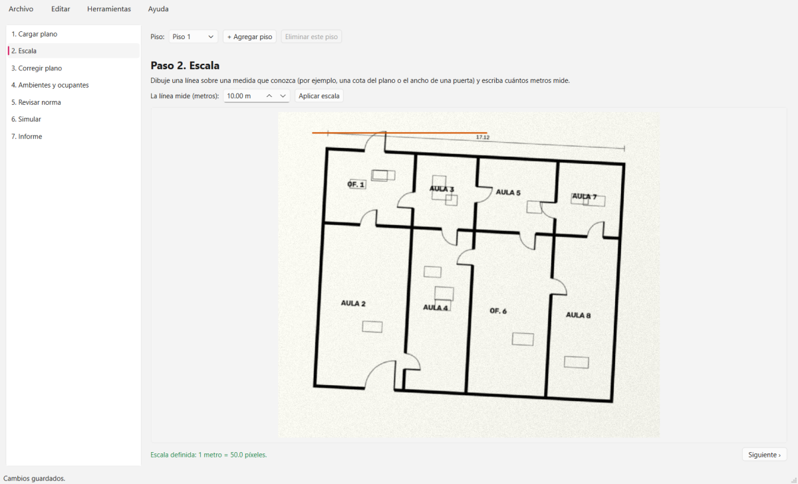

El programa necesita saber cuántos metros representa la imagen.

1. Busque en el plano una medida que conozca. Puede ser una cota (por ejemplo, «17.12») o el ancho
   de una puerta que pueda medir en el lugar.
2. Arrastre el mouse sobre esa medida para dibujar una línea.
3. Escriba cuántos metros mide y pulse **Aplicar escala**.

Sin escala no se pueden calcular el aforo, los anchos ni la simulación.

---

## Paso 3. Corregir plano

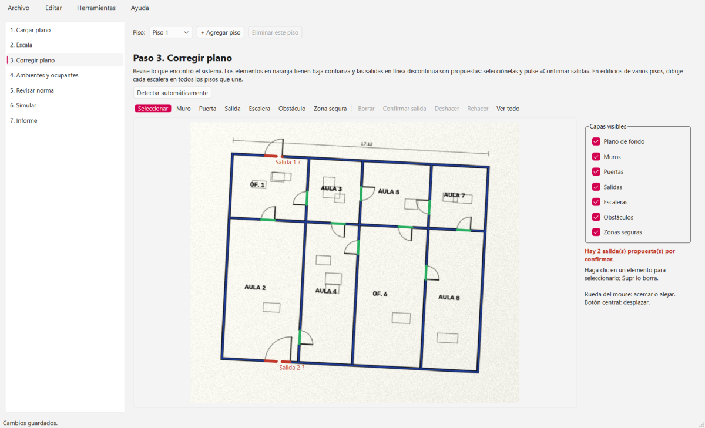

Al entrar, el programa **busca automáticamente** muros, puertas y salidas. Revise lo que encontró.

### Colores del plano

| Color | Qué es |
|---|---|
| Azul | Muro |
| Verde | Puerta |
| Rojo | Salida |
| Naranja discontinuo | Algo que el programa no está seguro de haber detectado bien |

### Herramientas

| Herramienta | Qué hace |
|---|---|
| **Seleccionar** | Hace clic sobre un elemento para elegirlo. **Supr** lo borra. |
| **Muro, Puerta, Salida** | Arrastre para dibujar. Con **Mayús** la línea queda recta. |
| **Escalera, Obstáculo, Zona segura** | Arrastre para dibujar un rectángulo. |
| **Deshacer / Rehacer** | Ctrl+Z / Ctrl+Y. |
| **Ver todo** | Muestra el plano completo. |

- **Moverse por el plano:** la rueda del mouse acerca y aleja; el botón central desplaza la vista.
- **Capas visibles:** permiten ocultar el fondo o un tipo de elemento para ver mejor.

### Salidas propuestas

Las salidas que encontró el programa aparecen **en línea discontinua con «?»**. Selecciónelas y
pulse **Confirmar salida**, o bórrelas si no son salidas. No se puede simular con salidas sin
confirmar.

**Zonas seguras:** si su local tiene una zona segura interna, como un patio, márquela. Las personas
que llegan a ella cuentan como evacuadas.

---

## Paso 4. Ambientes y ocupantes

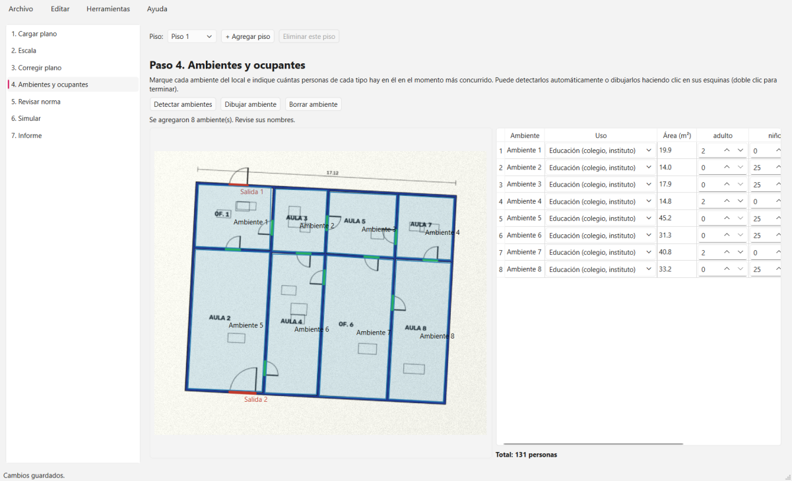

1. Pulse **Detectar ambientes**. El programa encuentra los espacios cerrados por muros y puertas.
2. Si falta alguno, pulse **Dibujar ambiente** y haga clic en cada esquina. Termine con doble clic.
3. En la tabla:
   - cambie el nombre de cada ambiente (doble clic sobre el nombre);
   - elija su uso;
   - indique **cuántas personas de cada tipo** hay en el momento más concurrido: adultos, niños y
     personas con movilidad reducida.

---

## Paso 5. Revisar norma

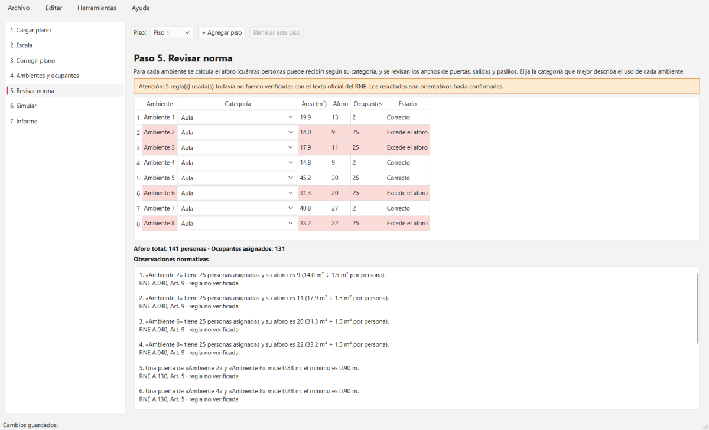

- **Aforo:** para cada ambiente se calcula cuántas personas puede recibir según su categoría (aula,
  taller, oficina, pasillo…). Elija la categoría que mejor describa cada ambiente. Los ambientes
  que superan su aforo aparecen en rojo.
- **Observaciones:** abajo se listan los problemas encontrados (aforo excedido, puertas o pasillos
  angostos, barra antipánico). Cada observación cita la norma y el artículo. Pase el mouse sobre
  una observación para ver la recomendación.

> Si aparece el aviso de **reglas no verificadas**, los valores normativos todavía no se
> contrastaron con el texto oficial del RNE. Los resultados son orientativos.

---

## Paso 6. Simular

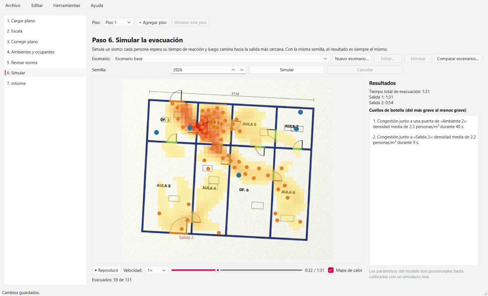

1. Pulse **Simular**. Cada persona espera su tiempo de reacción y luego camina hacia la salida más
   cercana. Puede **Cancelar** en cualquier momento.
2. Al terminar se reproduce la animación.
   - **Controles:** reproducir y pausa, velocidad (0.5× a 8×) y la barra de tiempo.
   - **Mapa de calor:** muestra dónde se acumuló la gente.
3. A la derecha verá:
   - el **tiempo total de evacuación**;
   - el tiempo de cada salida;
   - los **cuellos de botella**, del más grave al menos grave.

**Semilla:** con la misma semilla y los mismos datos, la simulación da siempre el mismo resultado.

### Escenarios «qué pasa si»

- **Nuevo escenario…** crea una variante del escenario base. Puede cambiar el porcentaje de
  personas (por ejemplo, 150 %) y marcar salidas bloqueadas.
- **Comparar escenarios…** muestra dos escenarios lado a lado:

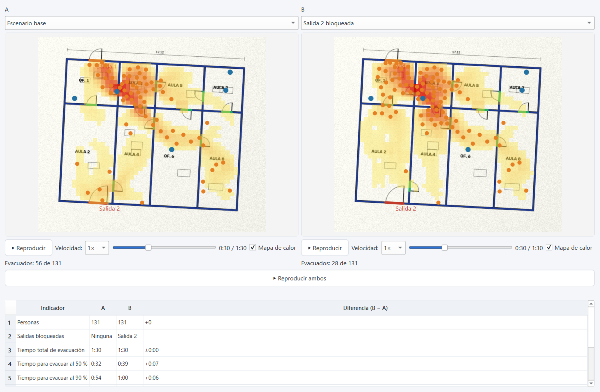

> El **tiempo total** suele depender de la persona que reacciona más tarde. Para ver el efecto de
> bloquear una salida o cambiar el aforo, mire el **tiempo para evacuar al 90 %** y los cuellos de
> botella.

---

## Paso 7. Informe

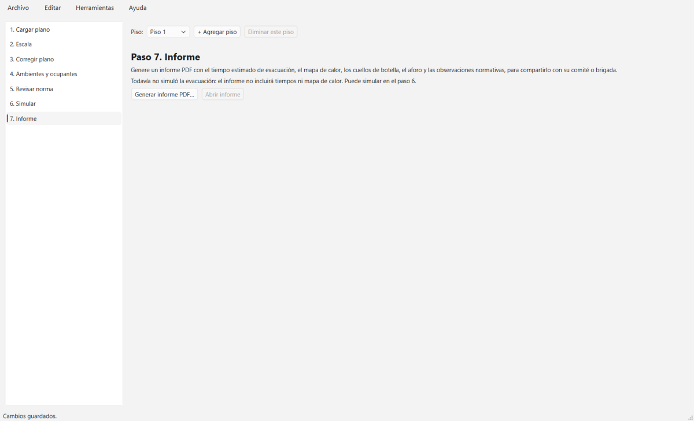

Pulse **Generar informe PDF…** y elija dónde guardarlo. Luego use **Abrir informe**. El informe
incluye:

- el resumen y el tiempo estimado;
- el aforo y las observaciones normativas con sus artículos;
- el mapa de calor, la curva de evacuados y los cuellos de botella con recomendaciones;
- la comparación de escenarios;
- los parámetros usados y la aclaración legal.

---

## Edificios de varios pisos

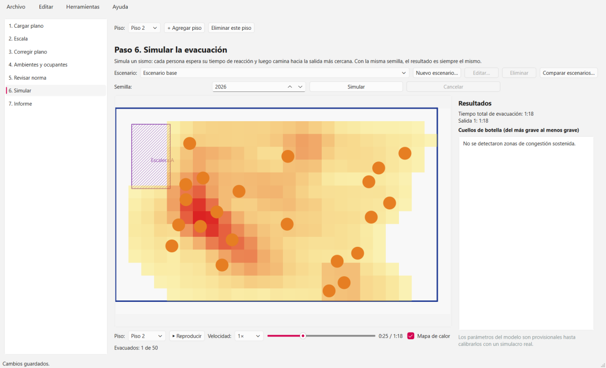

RutaSegura simula edificios de hasta 4 pisos.

1. Con el proyecto abierto, use la barra **Piso** (arriba) y pulse **+ Agregar piso**.
2. Para cada piso, haga los pasos 1 a 4: cargue su plano, defina su escala, corrija el plano y
   marque ambientes y ocupantes. El selector **Piso** indica en qué piso está trabajando.
3. **Escaleras.** Dibújelas en el paso 3, en **todos los pisos que unen**, en el mismo lugar del
   edificio. Se nombran solas («Escalera A», «Escalera B»…):
   - si las dibuja en el mismo orden en cada piso, quedan emparejadas;
   - si un piso tiene una sola escalera, se empareja con ella automáticamente.
4. En el paso 6 se simula **todo el edificio a la vez**.
   - Las personas de los pisos altos caminan hasta la escalera, bajan y salen por las salidas del
     piso 1.
   - Las escaleras tienen una capacidad: si llega mucha gente, se forma fila.
   - En el visor, el selector **Piso** muestra cada piso con su mapa de calor.

**Eliminar un piso:** solo se puede eliminar el piso más alto, nunca el piso 1. Si no lo tiene
abierto, cámbielo primero en el selector **Piso**.

---

## Calibrar con un simulacro real

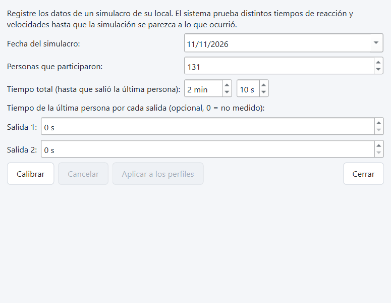

Si su local hizo un simulacro, puede usarlo para que la simulación se parezca más a la realidad.

1. Abra el menú **Herramientas › Calibrar con un simulacro real…**
2. Escriba la fecha, las personas que participaron y el tiempo total, es decir, cuándo salió la
   última persona. Si los midió, escriba también el tiempo por cada salida.
3. Pulse **Calibrar**. El programa prueba distintos tiempos de reacción y velocidades y muestra el
   error antes y después. La meta es un error menor que 20 %.
4. Si el resultado le parece razonable, pulse **Aplicar a los perfiles** y vuelva a simular.

Más detalles en [calibracion.md](calibracion.md).

---

## Preguntas frecuentes

**El programa no encontró bien los muros.**
Corríjalos en el paso 3. La detección funciona mejor con planos limpios, en blanco y negro y bien
enfocados. Si la foto está torcida, enderécela en el paso 1.

**Dice que las personas de un ambiente «no tienen una salida alcanzable».**
Revise que ese ambiente tenga una puerta, que no haya un muro cerrando el paso y que el local
tenga al menos una salida confirmada.

**Dice que una escalera «no tiene una escalera correspondiente» en otro piso.**
Dibuje la escalera también en el piso de abajo, en el mismo lugar. Si ese piso tiene varias
escaleras, dibújelas en el mismo orden que en el piso de arriba para que tengan los mismos
nombres.

**Dice que hay salidas propuestas sin confirmar.**
Vuelva al paso 3, seleccione las salidas con «?» y pulse **Confirmar salida**, o bórrelas.

**Cargué un plano nuevo y desapareció lo que había corregido.**
Al cargar otra imagen, el plano anterior ya no corresponde. Hay que corregir el plano nuevo.

**¿Cómo compruebo que la instalación está completa?**
Desde una ventana de comandos, ejecute:

```bash
RutaSegura.exe --self-test --log autoprueba.txt
```

Abra `autoprueba.txt`: todas las líneas deben decir «OK».

**¿Necesito internet?**
No. RutaSegura funciona completamente sin conexión.

---

## Glosario

| Término | Significado |
|---|---|
| **Aforo** | Cantidad máxima de personas que puede recibir un ambiente según la norma. |
| **Cuello de botella** | Lugar donde las personas se acumulan al salir, por ejemplo una puerta angosta. |
| **Escenario** | Una situación a simular: cuántas personas hay y qué salidas están disponibles. |
| **Mapa de calor** | Imagen que muestra en rojo dónde hubo más personas durante más tiempo. |
| **Semilla** | Número que fija el azar de la simulación, para que se pueda repetir igual. |
| **Tiempo de reacción** | Lo que tarda una persona en empezar a moverse después de la alarma. |
| **Zona segura** | Lugar protegido, por ejemplo un patio sin riesgo de caída de objetos, adonde se dirigen las personas. |
